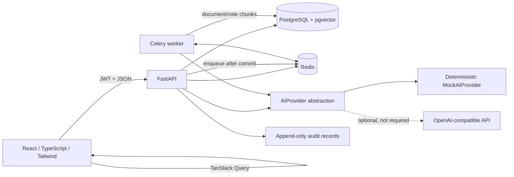

# TeamPulse AI — AI Operating System for Teams

TeamPulse AI is a full-stack, multi-tenant team workspace for projects, dependency-aware execution, team knowledge, and human-approved AI planning. It is a portfolio/interview project, not a claimed production deployment.

## What is implemented

### Product UI

- Responsive React 18 + TypeScript + Vite + Tailwind application
- React Router protected routes and destination-preserving login redirect
- TanStack Query server state plus explicit authentication/workspace context
- Registration, login, logout, refresh-token rotation, and session-expired messaging
- Workspace switching, creation, rename, owner deletion, member administration, and role-aware controls
- Project create/edit/delete and status management  
- Task list and accessible Kanban views, filters, assignment, priorities, due dates, and role-aware editing
- dnd-kit pointer/keyboard drag-and-drop with identifiable drop columns, drag overlay, optimistic status updates, rollback, and dependent-risk invalidation
- Task dependencies, cycle-safe API integration, deterministic risk badges, and human-readable risk reasons
- Dashboard greeting, four metrics, neutral AI Briefing, accessible risk distribution, needs-attention work, and next-five deadlines
- Project All/Active/Archived tabs with live health, progress, and deadline cards
- AI plan preview/review/approval/rejection; preview never creates projects or tasks
- Meeting-note save, extraction preview, selected-action approval, and project targeting
- UTF-8 `.txt`/`.md` upload, indexing status, content download, and confirmed deletion
- Search & Docs source tabs (All, Documents, Meeting notes, Tasks), typed result cards, and dismissible duplicate-task suggestions
- Paginated OWNER/ADMIN audit activity
- Loading, empty, error, permission, toast, mobile-navigation, and destructive-confirmation states

### Backend and data

- FastAPI modular monolith with versioned `/api/v1` routes
- PostgreSQL 16, SQLAlchemy 2, Alembic migrations, and pgvector
- Redis 7 and Celery for rate limiting and asynchronous embedding jobs
- Argon2 password hashing through `pwdlib`
- 15-minute JWT access tokens and 7-day rotating, hashed, revocable refresh tokens
- Workspace-scoped repositories and OWNER/ADMIN/MEMBER/VIEWER RBAC
- Soft deletion where applicable and append-only audit records
- Deterministic task risk and project-health calculations
- Strict AI response validation, assignee/reference checks, and dependency-cycle prevention
- Transactional, idempotent AI plan approval and selected meeting-action approval
- Chunked 1536-dimensional embeddings with bounded transient retries
- pgvector cosine search, PostgreSQL ranked full-text fallback, and SQLite test fallback
- Read-only AI weekly summary through the same provider abstraction

`AI_PROVIDER=mock` is the default. Mock mode needs no API key, payment, model download, or external AI request. Its deterministic placement-platform plan uses concise unique task descriptions, workspace-only suggested assignees, realistic dependencies, and neutral summaries; the brief is not copied into every description. Remote output remains server-side, schema-validated, and approval-gated.

### UI and drag-and-drop behavior

The light gray/lavender interface uses a fixed responsive sidebar, compact cards, visible focus states, semantic labels, and TeamPulse AI branding only. Kanban columns are explicit droppable regions with PointerSensor and KeyboardSensor support, a drag overlay, and highlighted targets. Editors optimistically move cards through the existing task `PATCH` endpoint; failed requests restore the prior status and show a safe error toast. Successful or failed moves invalidate task, project, dashboard summary, and all workspace task-enrichment queries so downstream risk (including BLOCKED dependencies) is refreshed. VIEWER users see a read-only board and cannot drag. Same-column ordering is visual only; no unsupported ordering API is called.

## Architecture



PostgreSQL is the source of truth. Raw AI output is untrusted data. It is parsed and validated into a pending proposal; only an explicit approval route can write its project/tasks. The browser mirrors backend permissions for usability, but FastAPI remains the enforcement boundary.

## Repository layout

```text
.github/workflows/ci.yml       # Ruff, pytest, frontend tests/build, Docker-backed E2E
backend/
  alembic/versions/            # Core and AI/search migrations
  app/
    api/routes/                # Auth, workspaces, projects, tasks, AI, notes, docs, search
    core/                      # Configuration, permissions, security, logging
    db/                        # Engine, portable types, rich idempotent demo seed
    models/                    # SQLAlchemy models and enums
    repositories/              # Tenant-scoped persistence queries
    schemas/                   # Pydantic API contracts
    services/
      ai/                      # Provider interface, mock, optional remote provider
      ai_validation.py         # AI reference and dependency validation
      proposals.py             # Plan preview/approval/rejection transactions
      meeting_actions.py       # Extraction and selected-action approval
      embeddings.py            # Chunking, enqueue, retries, idempotent execution
      risk.py                  # Deterministic task/project health
      search.py                # Vector/full-text/SQLite search and duplicates
    tests/                     # Unit and API integration tests
    workers/                   # Celery application and embedding jobs
frontend/
  e2e/                         # Five isolated Playwright scenarios
  src/
    auth/                      # Token/session provider and protected route
    workspace/                 # Workspace selection and permission matrix
    components/                # Accessible UI, forms, previews, notifications
    hooks/                     # API composition for task risks/dependencies
    pages/                     # Product routes
    test/                      # Vitest setup
docker-compose.yml             # PostgreSQL, Redis, API, worker, frontend
.env.example                   # Placeholders only; no usable secrets
docs/                          # Architecture, demo, and resume guidance
```

## Download and extract the source archive

After downloading `TeamPulse-AI-source.zip` into a local directory:

```bash
unzip TeamPulse-AI-source.zip
cd TeamPulse-AI
```

The archive contains a single top-level `TeamPulse-AI/` directory. It intentionally excludes `.env`, Git metadata, dependencies, virtual environments, caches, coverage, build output, test artifacts, and Docker volumes.

## Run locally with Docker Compose

### Prerequisites

- Docker Engine with Compose v2
- Node.js 20 and npm 10 for host-side frontend tests/E2E
- Python 3.11+ only if running backend tests directly on the host

### 1. Create local development configuration

```bash
cp .env.example .env
python3 -c "import secrets; print(secrets.token_urlsafe(48))"
```

Edit the new local `.env`:

- Set `POSTGRES_PASSWORD` to a local-only value.
- Set `JWT_SECRET_KEY` to the independently generated value.
- Keep `AI_PROVIDER=mock` and leave `OPENAI_API_KEY` empty.
- Never commit this file or print its values in a demo recording.

Compose reads `.env` for variable interpolation and passes only declared settings to containers. No real `.env` is included in the source archive.

### 2. Build and start the databases

```bash
docker compose build
docker compose up -d db redis
```

### 3. Apply every Alembic migration

```bash
docker compose run --rm backend alembic upgrade head
```

Migrations are deliberately not run automatically by the web container. The second migration creates AI/knowledge tables and the `vector(1536)` HNSW index.

### 4. Start the API, Celery worker, and frontend

```bash
docker compose up -d
docker compose ps
```

Open:

- Application: <http://localhost:5173>
- OpenAPI: <http://localhost:8000/docs>
- Liveness: <http://localhost:8000/health>
- Readiness: <http://localhost:8000/ready>

Useful diagnostics:

```bash
docker compose logs backend
docker compose logs celery-worker
docker compose exec celery-worker celery -A app.workers.celery_app inspect ping
```

## Rich interview demo seed

The idempotent seed creates:

- Workspace: **Placement Prep Team**
- Project: **Placement Preparation Platform**
- Four role-based users: owner, admin, member, and viewer
- Nine Title Case placement-platform tasks and three dependencies
- `Build Authentication` is BLOCKED; `Create Resume Builder` depends on it; `Build Placement Dashboard` depends on both resume builder and `Implement Job Tracker`
- Placement-preparation meeting note and runbook document
- Deterministic embeddings and audit records

After migrations and with the backend running:

```bash
read -rsp "Development seed password: " SEED_USER_PASSWORD; echo
docker compose exec \
  -e SEED_USER_PASSWORD="$SEED_USER_PASSWORD" \
  backend python -m app.db.seed
unset SEED_USER_PASSWORD
```

Default local email identities (the password is intentionally not shown here):

- `owner.demo@teampulse.app` — OWNER
- `admin.demo@teampulse.app` — ADMIN
- `member.demo@teampulse.app` — MEMBER
- `viewer.demo@teampulse.app` — VIEWER

Use the runtime password you supplied to sign in as any of these users; no password is hardcoded, logged, or printed by the seed. Email overrides are documented in `.env.example` and validated as real email addresses. Rerunning the seed does not duplicate demo records or reset existing task state.

## Tests and validation

### Backend directly on the host

Tests override application settings, use isolated in-memory SQLite, reset process-local limiter state, and force `MockAIProvider`. They do not need Docker, PostgreSQL, Redis, Celery, or an AI key.

```bash
cd backend
python3 -m venv .venv
source .venv/bin/activate
python -m pip install --upgrade pip
python -m pip install -r requirements-dev.txt
python -m pytest -q
python -m ruff check app
```

Current enhancement-task result: **57 backend tests passed** and **Ruff: All checks passed**.

### Frontend unit tests and production build

```bash
cd frontend
npm ci
npm test
npm run build
```

Current enhancement-task result: **7 test files / 12 unit tests passed**, plus successful strict TypeScript and Vite production build (**116 modules transformed**). Tests cover protected redirect, login/session redirect, workspace switching, AI preview labeling, risk reasons, permission-restricted controls, permitted Kanban drops, same-column no-op behavior, and VIEWER-no-drag behavior.

### Playwright E2E with Docker-backed services

Keep `AI_PROVIDER=mock`, start Compose, and apply migrations first. Then:

```bash
cd frontend
npm ci
npx playwright install chromium
E2E_SKIP_WEBSERVER=1 \
E2E_BASE_URL=http://127.0.0.1:5173 \
E2E_API_BASE_URL=http://127.0.0.1:8000/api/v1 \
npm run e2e
```

The five scenarios cover:

1. Registration, logout, and login
2. Workspace → project → task
3. Blocked-dependency downstream risk
4. MockAIProvider preview with no writes before approval, then approved creation
5. Tenant isolation across workspaces and task IDs

Credentials are generated at runtime, workspaces have unique names, and no real AI keys are used. Two worker-scoped identities are reused to respect the real login rate limit; each scenario uses separate workspace data.

**Sandbox status:** Docker is unavailable in this enhancement-task sandbox, so Compose services, migrations, container seed execution, and Playwright scenarios were **not executed**. The five scenarios remain authored; do not interpret earlier discovery or the unit/build checks as an E2E pass.

### CI

`.github/workflows/ci.yml` contains three jobs:

- `backend`: dependency install, Ruff, pytest
- `frontend`: `npm ci`, Vitest, TypeScript/Vite build
- `e2e`: generated disposable runner settings, Docker Compose, Alembic migration, Chromium, five Playwright tests with mock AI

CI contains no committed `.env`, credentials, API keys, or tokens. Disposable PostgreSQL/JWT values are generated into the runner environment at execution time. No deployment job is defined.

## Environment variables

| Variable | Purpose |
|---|---|
| `APP_ENV` | `development`, `test`, or `production` |
| `LOG_LEVEL` | Application logging threshold |
| `POSTGRES_DB`, `POSTGRES_USER`, `POSTGRES_PASSWORD` | PostgreSQL container configuration |
| `DATABASE_URL` | SQLAlchemy URL; constructed by Compose, set manually for host-only development |
| `REDIS_URL` | Redis/Celery/readiness/rate-limit URL; constructed by Compose |
| `JWT_SECRET_KEY` | Required independent random signing secret, minimum 32 characters |
| `CORS_ORIGINS` | Comma-separated browser origins; wildcard rejected in production |
| `TRUST_PROXY_HEADERS` | Enable only behind a trusted, header-sanitizing proxy |
| `AI_PROVIDER` | Server-only `mock` (default) or `openai_compatible` |
| `OPENAI_API_KEY` | Optional runtime secret; empty in mock mode and never exposed to the browser |
| `OPENAI_BASE_URL`, `OPENAI_MODEL` | Optional OpenAI-compatible endpoint and chat model configuration |
| `EMBEDDING_MODEL` | Optional provider embedding model |
| `DOCUMENT_MAX_UPLOAD_MB` | Document limit, default and maximum 5 MB |
| `VITE_API_BASE_URL` | Browser-facing API prefix for the frontend container |
| `SEED_OWNER_EMAIL`, `SEED_ADMIN_EMAIL`, `SEED_MEMBER_EMAIL`, `SEED_VIEWER_EMAIL` | Validated demo identity overrides |
| `SEED_USER_PASSWORD` | Shared demo password supplied only at seed time |
| `E2E_BASE_URL`, `E2E_API_BASE_URL` | Browser/API endpoints used only by Playwright |
| `E2E_SKIP_WEBSERVER` | Set to `1` when Compose already serves the frontend |

### Optional Groq chat setup

Groq can be used through the existing server-side OpenAI-compatible provider; it is not required for development or tests. Set these only in your runtime environment, never in frontend code or the committed example file:

```bash
AI_PROVIDER=openai_compatible
OPENAI_BASE_URL=https://api.groq.com/openai/v1
OPENAI_MODEL=llama-3.3-70b-versatile
# OPENAI_API_KEY is supplied separately by your secret manager/runtime.
```

The provider validates JSON responses and converts failures to safe API errors. Confirm that your chosen endpoint also supports the configured embedding model before enabling remote document indexing; mock mode remains the no-key, fully offline default.

## AI approval contracts

### Project plan

1. OWNER/ADMIN submits `brief` to `POST /workspaces/{id}/ai/plans/preview`.
2. Strict models validate project/tasks, owners, keys, dates, dependencies, risks, and assumptions.
3. Only a `PENDING` proposal and audit event are saved.
4. The UI labels the result **AI suggestion — not saved yet**.
5. Explicit approval revalidates current workspace users/dependencies and creates records in one transaction.
6. The stored result contains created project/task/dependency IDs. Replay returns the approved result without duplicates.
7. Rejection changes proposal state only and cannot later be approved.

### Meeting extraction

1. OWNER/ADMIN/MEMBER saves a titled note, optionally linked to a project.
2. Extraction creates a pending summary/decisions/action-items proposal.
3. The reviewer selects specific action keys and a valid workspace project.
4. Only selected actions become tasks during approval. Approval replay is idempotent.

### Weekly summary

The read-only weekly-summary route derives current project-health/task input and returns strict `summary`, `highlights`, and `recommended_actions` fields. It does not write a proposal or modify team work.

## Risk rules

- Completed tasks are `ON_TRACK`.
- A task marked blocked is `BLOCKED`; an incomplete past-due task is `OVERDUE`.
- Blocked, overdue, or incomplete dependencies due within two UTC calendar days make a task `AT_RISK` with explicit reasons.
- Project health is `CRITICAL` for blocked/overdue active tasks, `AT_RISK` for dependency risk, otherwise `ON_TRACK`.
- Dependency self-links and cycles are rejected by the backend.

## Documents, embeddings, and search

- Pasted text or UTF-8 `.txt`/`.md` files, up to 5 MB
- Sanitized filenames and safe 413/415/422 responses
- Overlapping word chunks and exactly 1536-dimensional vectors
- Celery enqueue after commit; bounded transient retries and safe source status
- Atomic chunk replacement for idempotent reindexing
- Workspace/source filters before vector ranking
- PostgreSQL pgvector cosine search when embeddings are available
- Parameterized PostgreSQL `to_tsvector` / `plainto_tsquery` / `ts_rank` fallback
- Parameterized SQLite `ILIKE` fallback for tests
- Task text search and deterministic title-based duplicate suggestions; tasks do not have embedding jobs

## RBAC summary

| Capability | OWNER | ADMIN | MEMBER | VIEWER |
|---|---:|---:|---:|---:|
| Read workspace data | ✓ | ✓ | ✓ | ✓ |
| Create/edit tasks, notes, documents | ✓ | ✓ | ✓ | — |
| Manage projects and AI plans | ✓ | ✓ | — | — |
| Delete tasks | ✓ | ✓ | — | — |
| Manage members and view audit | ✓ | ✓ | — | — |
| Rename/delete workspace | ✓ / delete | rename only | — | — |

Frontend controls reflect this matrix, but every API route independently enforces membership and role.

## Security notes

- Password hashes use Argon2; raw passwords are never stored by the application.
- Refresh tokens are stored as SHA-256 hashes, rotated, and revocable.
- Login: 5 requests/minute/IP. AI workflows: 10/minute/authenticated user. Search/duplicates: 30/minute/authenticated user.
- Production Redis limiter failures fail safely; development/test in-memory fallback is not suitable for multi-instance production.
- Forwarded IP headers are ignored unless explicitly trusted.
- Tenant-owned records and search queries are workspace-scoped.
- AI output is never executed as SQL, shell, URLs, tools, or direct writes.
- Uploaded/pasted content and briefs are untrusted reference data.
- API/UI errors avoid stack traces, raw provider responses, and secrets.
- Browser tokens currently use `localStorage`; a production hardened deployment should consider Secure HttpOnly refresh cookies with an appropriate CSRF design.
- Logout revokes the refresh token but cannot revoke an already-issued access token before its short expiry.

## Deployment guide (not a deployment claim)

No hosted deployment was performed. For a real deployment:

1. Use managed PostgreSQL with pgvector and Redis, or carefully operated equivalents with backups.
2. Inject independent production secrets through a secret manager; never reuse demo/CI values.
3. Set `APP_ENV=production`, exact HTTPS `CORS_ORIGINS`, and trusted-proxy settings only when the proxy sanitizes forwarding headers.
4. Build and run stateless API containers; run `alembic upgrade head` as a controlled release step.
5. Run at least one Celery worker with the same provider/database configuration and monitor retries/failures.
6. Build the Vite app and serve `dist/` over HTTPS with SPA route fallback and a configured API origin.
7. Add TLS, security headers, backup/restore drills, centralized logs, metrics, alerting, and rate-limit monitoring.
8. Reassess refresh-token storage/CSRF and access-token revocation before exposing sensitive production data.

## Known limitations and pending runtime checks

- Real Docker Compose, PostgreSQL/pgvector, Redis, and Celery execution was not available in the sandbox.
- PostgreSQL migration application and ranked full-text/pgvector query execution still require runtime verification. Offline Alembic SQL rendering and SQLite tests passed in earlier phases; Phase 4 did not alter migrations.
- Playwright scenarios are authored but were not executed in this enhancement-task sandbox because Docker is unavailable.
- The optional OpenAI-compatible provider is implemented but was not called or tested with a real key.
- Mock embeddings capture lexical overlap, not production-quality semantic meaning.
- Large-source vectors are generated in memory before atomic chunk replacement; streaming/batched writes are future scaling work.
- List/board task enrichment composes the existing per-task risk/dependency endpoints; a bulk read endpoint would reduce requests for larger workspaces.
- No load-test, uptime, user-scale, or production-deployment claim is made.

## Manual Git setup (not executed by the build agent)

The archive has no `.git` directory. After inspecting the extracted source and confirming `.env` is absent:

```bash
git init
git add .
git status --short
git commit -m "Build TeamPulse AI"
git branch -M main
```

If you later choose to publish it, create a repository yourself, add its URL as `origin`, review `git diff --cached`, and push using your own credentials. No remote access, commit, or push is required to run the project.

See also:

- [`docs/PROJECT_EXPLANATION.md`](docs/PROJECT_EXPLANATION.md)
- [`docs/INTERVIEW_DEMO_GUIDE.md`](docs/INTERVIEW_DEMO_GUIDE.md)
- [`docs/RESUME_BULLETS.md`](docs/RESUME_BULLETS.md)
